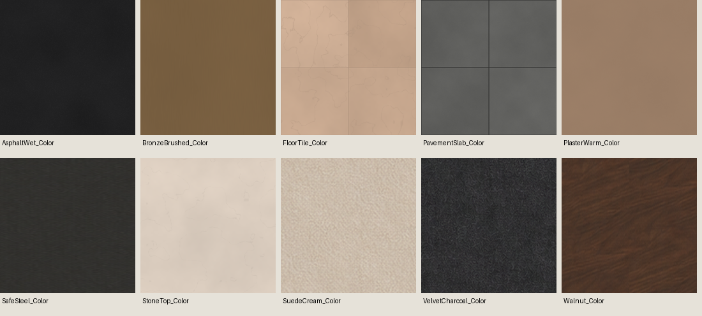
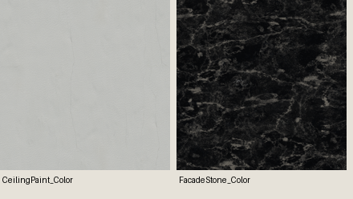
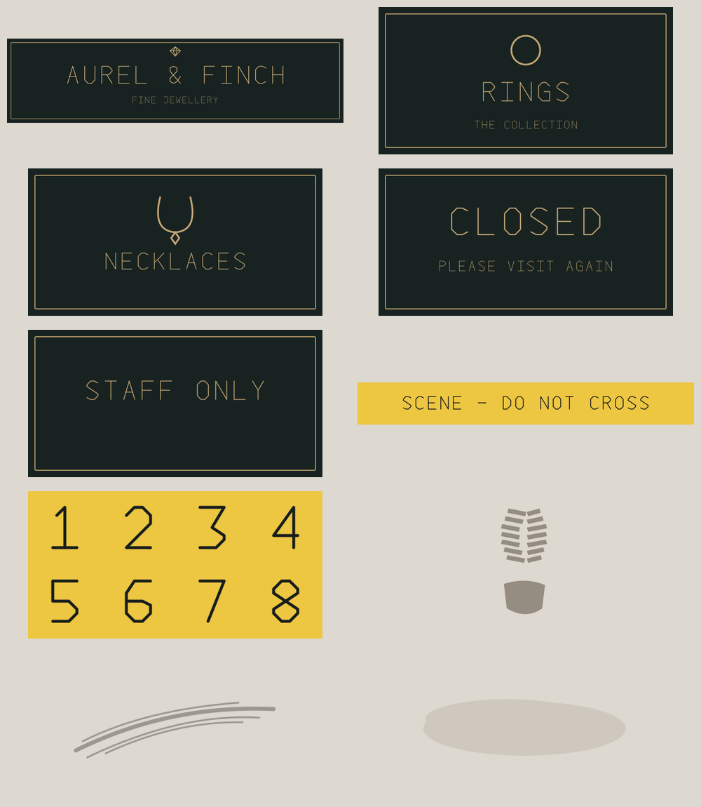

# Night-store asset preparation — October 11, 2026

Asset preparation on baseline `8dbbb49fa05d33152ec5bf23e3659b8be1e29cdb`.
Read README, project brief, night arrival/layout plans, roadmap, handoff, asset register
and current StoreKit/NightStore import paths first. No AGENTS.md found in the checkout.
Root `for Koda.md` was absent and has now been created. Current source was cloned from
GitHub because the PC's extracted Unity projects predate the night-store source.

## Deliverables

| Folder under Prototype/ThirdParty | Prepared content | Provenance |
|---|---|---|
| NightMaterials | 28 PNG maps: two 4-map surfaces and ten 2-map constant finishes | ambientCG CC0 plus project-authored scalar maps |
| NightGraphics | 10 PNG/SVG pairs: signs, tape, marker atlas, three generic decals | Original vector artwork and outlined lettering; no external font |
| NightAudio | 5 mono PCM16 WAVs; 4 unchanged source OGGs retained | Kenney CC0 plus original filtered-noise loop |
| NightModelReuse | 12-file manifest with triangle counts, source bounds and hashes | Existing KayKit CC0 assets reused in place |

All folders include LICENSE.txt and an import/reuse README. Source archive URLs and hashes
are in sources.json. Reproduction tools are in Tools. Download archives and temporary
Python dependencies are excluded via .asset-cache/; no whole unrelated pack was committed.
The asset-only zip in Downloads contains these four folders, preparation tools and the
report, previews and root note. Historical Unity downloads remain unchanged.

Materials are from [PaintedPlaster017](https://ambientcg.com/view?id=PaintedPlaster017)
and [Marble006](https://ambientcg.com/view?id=Marble006), released under
[ambientCG's CC0 terms](https://docs.ambientcg.com/license/). Interaction clips come from
[Kenney Interface Sounds](https://kenney.nl/assets/interface-sounds), also CC0.
No new CC-BY asset has been introduced. Existing CC-BY notices elsewhere remain intact.

## Visual review

Existing references retained: ten 1024px Color/Normal sets. Their charcoal upholstery,
warm stone and walnut palette are coherent for continued blockout review. Render-derived
normals and material fidelity still need evaluation under the actual night flashlight.
Missing CeilingPaint/FacadeStone and Roughness were confirmed. No reference image was
used as a texture source in this new batch.

New ceiling is subtle pale plaster; facade is dark marble. These are proposed finishes,
not calibrated reproductions of the storefront. Both have Color, OpenGL Normal,
Roughness and packed MetallicSmoothness. No displacement map or geometry added.

Fictional Aurel & Finch sign family uses charcoal green and muted brass. Decals are
generic illustrations without an asserted forensic identity. They remain unplaced.

## Model reuse

The full police car assembly is **1,316 triangles** including four wheels. Optional
furniture ranges from 276 to 636 triangles; the bench is 44. See
[raw OBJ measurements](AssetPreparation/model-audit.md) and NightModelReuse/models.json.
No model files were changed. Keep the existing procedural StoreKit cases, safes, hinged
doors, camera and lights: a static imported replacement would require behavior/pivot work.

## Verification and limits

`Tools/audit_night_assets.py` passed: 38 PNG files decoded, dimensions power-of-two and
at most 1024px; 12 packed-map pairs have exact inverted roughness alpha; new normals
remain unit length within quantization tolerance; five WAVs decode as mono PCM16 and
have nonzero, non-clipping levels; all 12 OBJ indices and MTL/atlas references resolve.
The original 20 ReferenceTextures images are unchanged in Git. Visual contact sheets
were opened and inspected. Machine-readable measurements: AssetPreparation/validation.json.

The 16-second periodic bed peaks near -22 dBFS. Interaction peaks are at or below -12
dBFS after edge fades. Their perceived quality/mix has not been auditioned in Unity.
No new assets are automatically assigned; no C# runtime, scene or shader changes.
StoreKit currently ignores roughness maps, and cladding has no texture name; AmbientSound
and EvidenceCamera generate/assign their existing sounds. Folder READMEs record the
explicit integration needed and inexpensive defaults for the Built-in pipeline.

No Unity compilation/import, lighting bake, Play-mode checks, new Unity snapshot,
Quest comfort/FPS test or standalone executable was produced. User decisions and
remaining manual work are in [for Koda.md](../for%20Koda.md).
