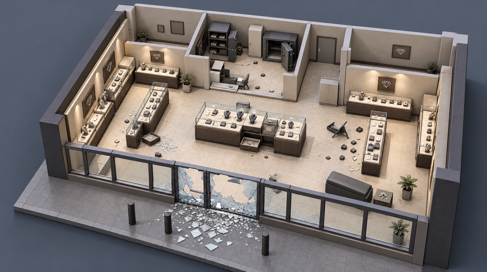
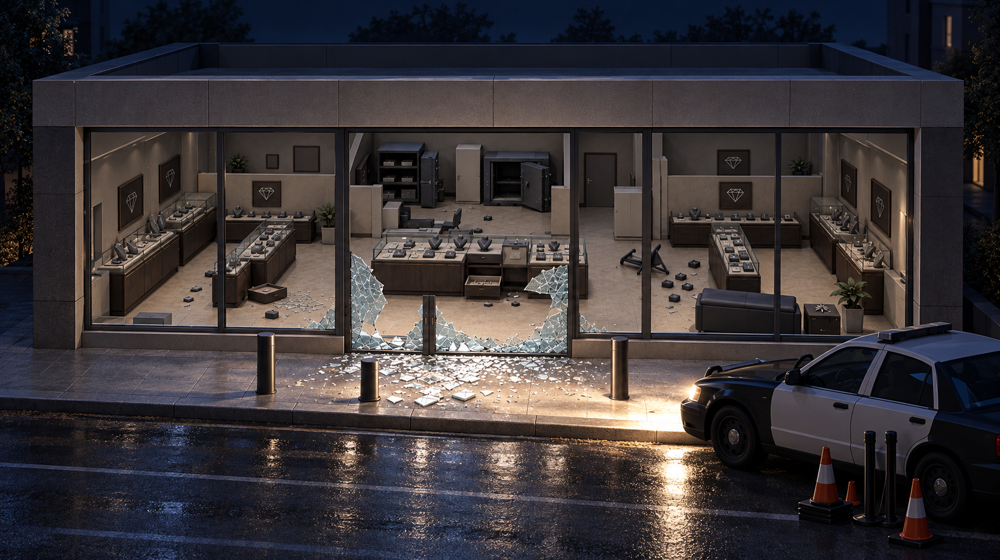
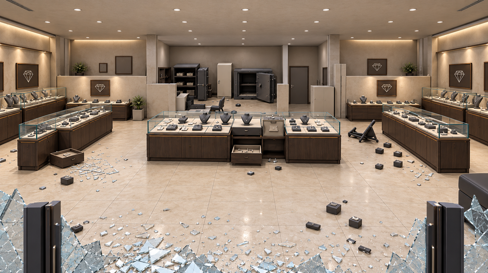
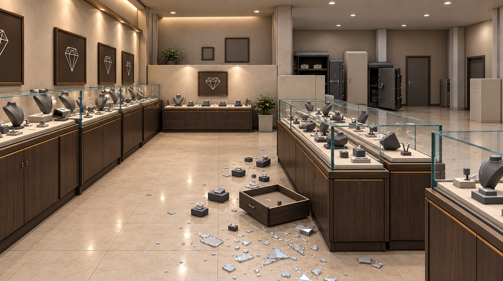
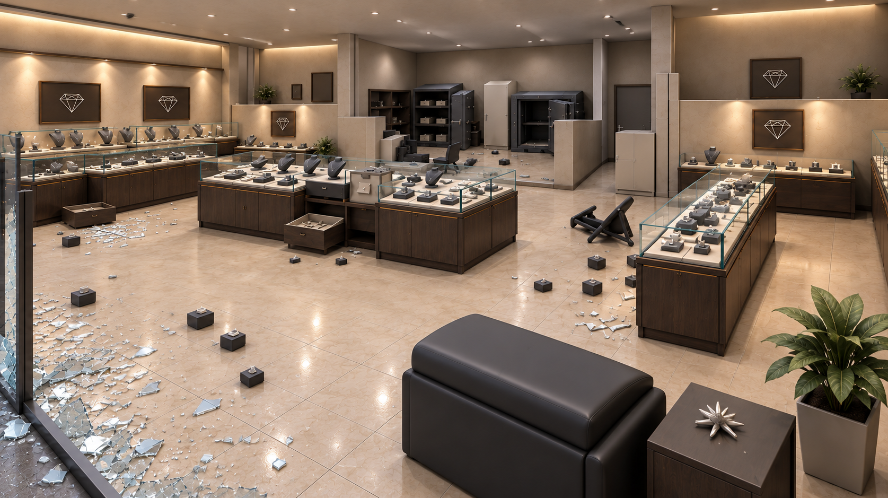
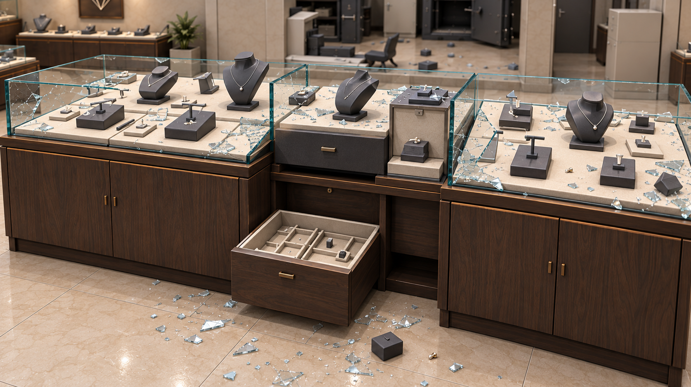
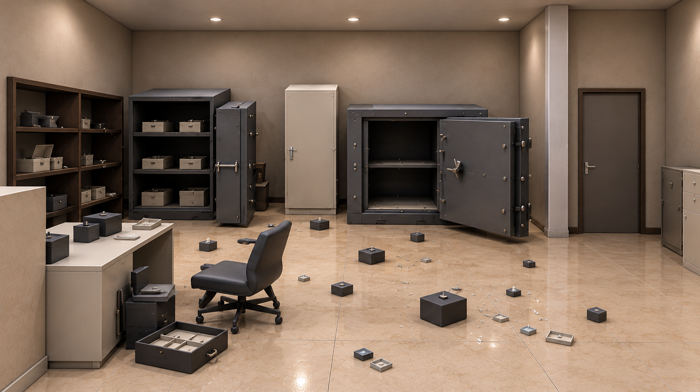
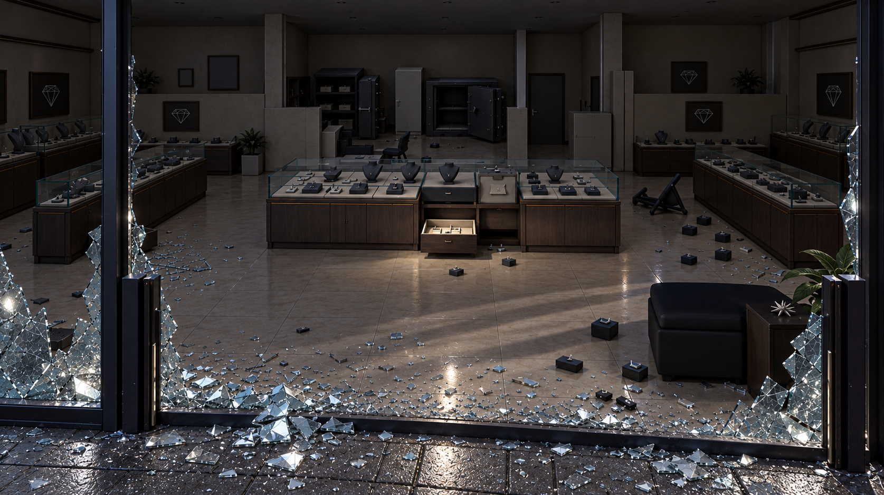

# Expanded jewelry store — eight modeling references
Generated October 11, 2026 from the user's store reference and [layout plan](../../REFERENCE_LAYOUT_PLAN.md).

These are AI-generated concept images, not screenshots of a built Unity/Blender model. Eight separate original PNG files are stored here. No scene/code/build was changed by this image-generation pass.

## How to use the set
Authority order: written layout and eventual measured blockout -> image 01 for overall spatial relationships -> other images for viewpoint and detail suggestions. The 16 x 12 m footprint is still a proposed estimate, not a measured dimension inferred from a render.

Fixed landmarks: centered broken south entrance, wide glazed facade, horizontal three-module central display cluster, two long north-south side islands, side-wall cases, rear central office with exactly two safes, rear side partitions, southeast/front-right seating.

Views 01 and 03–07 deliberately use diagnostic lighting so geometry is readable. Views 02 and 08 explore the nighttime arrival. In the actual scenario store fixtures start OFF. Keep the whole ceiling in the playable model; the cutaway is only a viewing aid.

## Consistency review and modeling cautions
The set maintains the principal spatial landmarks, but separately generated images are not exact projections of one 3D mesh. Do not trace conflicting details literally.
- Mullion spacing, pane cracks, safe-door proportions, case trim, fixture count and tiny props vary. Establish these once in the model and reuse the same modules.
- The illuminated interior views show more remaining jewelry than the intended robbed state. Keep the approved empty/tipped-stock plan when dressing the scene.
- View 02 is a mood reference: car aiming, headlight illumination and residual-looking interior brightness require physically correct placement in Unity. View 08 is the stronger lights-off reference.
- Generated partitions/ceiling details do not resolve hidden architecture. Keep the reference-layout room assumptions explicit; choose full-height or partial partitions deliberately in the model.
- Glossy floors, numerous shards, detailed jewelry and soft photographic lighting are aspirational appearance, not the low-poly/performance specification. Use economical geometry, subdued materials, fewer shards and measured VR lighting.
- No dimensions or camera transforms should be measured from image pixels. Intended view descriptions are recorded in manifest.json; they are not calibrated cameras.

## Gallery
### 01 — Cutaway overview — primary spatial reference

High south-west isometric. Roof hidden only for illustration; diagnostic lighting.

[Download original PNG](01-cutaway-overview.png)

### 02 — Night exterior — wide frontage and arrival

Exterior south, facing north. Parked car and headlight mood; facade dimensions still follow the plan.

[Download original PNG](02-night-exterior-wide.png)

### 03 — Entrance interior — main showroom sightline

Entrance facing rear office. Diagnostic lights on for shape readability.

[Download original PNG](03-entrance-interior-wide.png)

### 04 — Left display aisle — circulation and wall cases

Left-side aisle view. Illustrative perspective, not a surveyed camera transform.

[Download original PNG](04-left-display-aisle.png)

### 05 — Right aisle and seating — southeast corner

Front-right corner toward center/rear. Sofa/table should remain in southeast zone.

[Download original PNG](05-right-aisle-and-seating.png)

### 06 — Central display detail — glass, cabinetry and drawer

South face of center island. Construction/material reference only; simplify mesh details.

[Download original PNG](06-central-display-detail.png)

### 07 — Rear safe office — two safes and workstation

Rear office from its south opening. Keep exactly two safes, not a new room layout.

[Download original PNG](07-rear-safe-office.png)

### 08 — Night entrance close-up — broken frontage and light

Pavement at central threshold facing north. Lights-off scenario mood and supported debris.

[Download original PNG](08-night-entrance-closeup.png)

## Next use
Block out the store with the existing reusable assets; capture these same eight approximate views from one actual Unity/Blender scene. That next set will provide true geometric consistency across angles. Keep these originals for design comparison.
