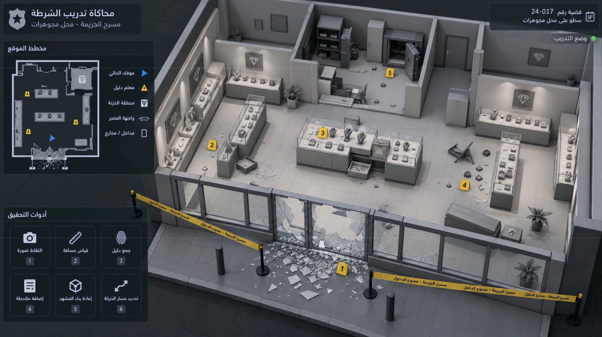

# Reference-based store layout
October 11, 2026 — design plan, not an implemented or tested scene.

Reference: [store-reference.jpg](../store-reference.jpg), inspected visually. Git blob: 967fbbf953a426fe0b700551a65986b589243754. The larger original screenshot remains in the repository.



## What is visible
The main isometric view shows:
- A wide rectangular shop with a nearly full-width framed-glass frontage and major breakage around its central entrance/frontage.
- A broad showroom with a central display cluster, long freestanding cases on the left and right, and additional wall cabinets.
- Rear display counters and framed jewelry signage.
- A central rear office/security area containing two open safes, shelving/storage and a desk/work area.
- Partitioned rear spaces to the left and right; their full room functions and connections cannot be established from this single view.
- Seating near the front-right glazing, plants, a fallen chair, open drawers/trays and scattered items.
- Pavement outside, tape on posts, bollards and a concentrated glass scatter beneath the damaged frontage.

The image is a presentation reference, not a measured architectural drawing. Its small inset map is simplified and not a reliable dimensional match for every object in the main view. Prioritize the main view's proportions, frontage, display relationships and rear room arrangement.

The roof and portions of walls are cut away for visibility. Keep a normal ceiling and full-height building shell in first-person mode; only an overview capture may hide them.

The interface graphics, case number, large minimap and numbered markers are not requirements to reproduce. Retain the instructor-led controls already planned. Tools and tape start available for deployment, rather than permanently completing the scene setup shown in the reference.

## Proposed first blockout dimensions
These are working estimates, not measurements recovered from the image. Adjust after the first human-height walkthrough and same-angle comparison.

| Element | Proposed starting size |
|---|---|
| Store footprint | 16 m wide x 12 m deep |
| Main showroom | Front 8.5 m of depth |
| Rear room band | Remaining 3.5 m |
| Ceiling | Approximately 3 m |
| Central entrance opening | Approximately 1.6–2 m; damaged adjacent panes widen the visible break-in area |
| Accessible frontage pavement | Approximately 3 m deep |
| Exterior car staging | A small connected bay beyond the pavement, sized around the parked car |
| Main circulation routes | Aim for 1.2–1.5 m clear, then verify controllers, collision and sightlines |

The prior showroom was approximately 10 x 8 m. Build a new shell; do not uniformly scale its displays, safe, markers or player rig.

## Zone arrangement
Conceptual plan only, not to scale. Front/street is at the bottom.

```text
REAR
+------------------+----------------------+------------------+
| rear left room   | office / two safes   | rear right room  |
| function pending | storage + work desk  | function pending |
+---rear displays--+----accessible route--+---rear displays--+
| wall case                                            wall |
|          long left case       long right case        case |
|                       central                             |
|                    display cluster                        |
|                 clear circulation                         |
|                                      front-right seating |
+-----framed glazing---central entry / breakage---glazing----+
|          accessible pavement / loose glass                 |
|            deployable tape and cones                      |
+-----------------------------------------------------------+
                  parked police car
                headlights toward store
STREET / VISUAL-ONLY NEIGHBORHOOD BEYOND PLAY AREA
```

This diagram describes relationships. The showroom is not required to be perfectly symmetrical: preserve the reference's offset furniture and disturbed arrangement. Car position is a scenario addition; no police car is visible in the reference.

## Reuse and change by zone
| Zone | Reuse | Change/add |
|---|---|---|
| Frontage | Existing glass shader, fragment meshes, trim and doors | Repeat mullion modules over the wider facade; concentrate breakage near center; seat debris on pavement/interior surfaces |
| Showroom | Current case, pad, stand, jewelry and drawer components | Rearrange into central cluster plus long side cases; keep several emptied/overturned displays |
| Walls | Current wall-cabinet forms and signs | Extend displays, use a consistent trim height; reposition signs rather than stretch text |
| Rear office | Existing safe and cabinet assets | Second safe instance, office desk/work area, separate safe door controls |
| Seating | Available furniture pack | Choose one coherent sofa/bench and small table; preserve frontage access |
| Exterior | Existing police-car and city assets | Make only the arrival bay and pavement playable; headlights aimed through frontage |
| Tools | Current cones, markers, tape and screenshot system | Equipment access near the car; generic DSLR visual; white/UV inspection light and optional lamp |

The reference appears to show a small threshold/step into the rear office. For the initial VR blockout, use a flush doorway or subtle accessible transition rather than a movement trap; record this as a deliberate adaptation.

## Night scenario adaptation
The reference is brightly lit so its layout is legible. Match its architecture and arrangement, then apply the user's separate midnight scenario:
- General shop lights and fixture emission off at arrival.
- A parked police car faces the shop, with headlights providing localized illumination through glazing and broken openings.
- Spawn beside the car; a driving sequence remains outside the initial build.
- Preserve dark areas for the white flashlight; optional scene lamp supplements the headlights.
- UV response is authored for selected simulated traces, restricted by the beam and occlusion, and is not automatic evidence identification.
- Reflective glass must use a matching night environment; no bright daytime reflection left behind.
- Keep an instructor diagnostic daylight view for comparing the layout to this image.

Potential evidence zones are frontage breakage, disrupted left display, open central drawers, scattered items/fallen chair on the right, and rear safe area. These are locations for instructor-authored case dressing, not predetermined correct marker placements.

## Implementation order and dependencies
1. Preserve the old shop. Create a separate scene and layout definition with named anchors for frontage, entry, cases, office doors, both safes, car, equipment and evidence.
2. Build floor, walls and ceiling with simple materials. Place old cases/safes at real scale; add a second safe and only essential partitions.
3. Open the entrance route. Replace the old blanket front barrier with frame/glazing collision and an outer playable boundary.
4. Update movement, teleport and placement bounds together. Reframe the overview and instructor review sketch for interior plus staging.
5. Generalize single-safe state handling so both doors restore reliably. Re-stage intact/robbed props and reset positions against the new anchors.
6. Establish night lighting, then reconnect tools, photo framing and car-side access.
7. Capture the same high isometric angle as the reference plus eye-level frontage, central aisle and safe-area views.
8. Verify routes, tool placement/removal, tape, lighting occlusion and photograph persistence; profile in the headset before textures.

Existing procedural generators contain many fixed coordinates. Do not stretch their output or replace their global defaults for all historical scenes. Introduce a separate layout-driven generation path and reuse component builders where practical.

## Decisions still open
- Exact dimensions: no dimensioned plan is supplied; use the above estimates until a walkthrough establishes appropriate scale.
- Rear side rooms: retain plausible simple partitions provisionally; do not claim exact hidden room layouts.
- Precise entrance leaf/glass damage geometry: settle from a front-facing blockout view.
- UV trace choice and meaning: instructor decision.
- Portable lamp: optional after headlights and white flashlight are usable.

Reference received and analyzed. No Unity scene, model, texture, code or build was changed in this planning update.
