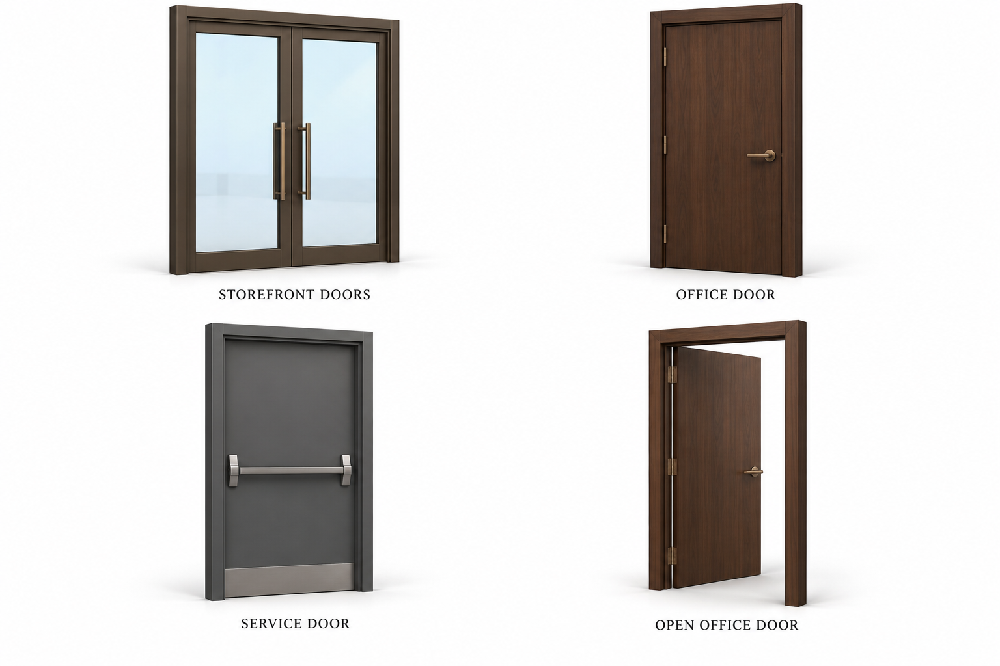
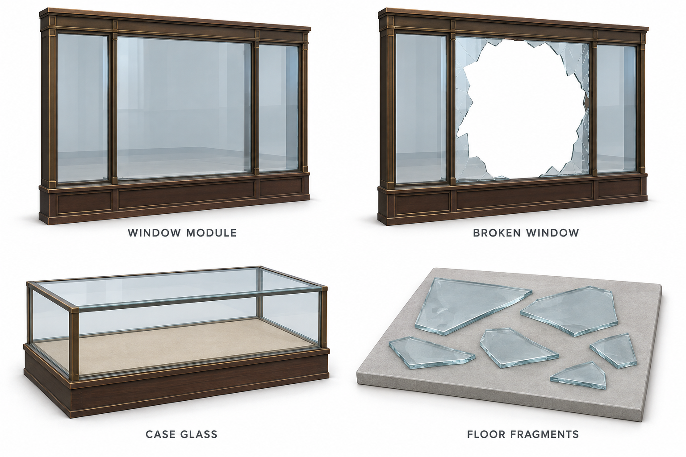
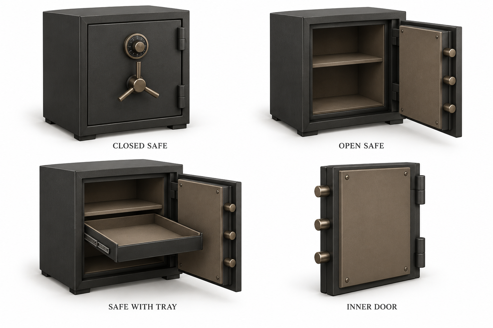
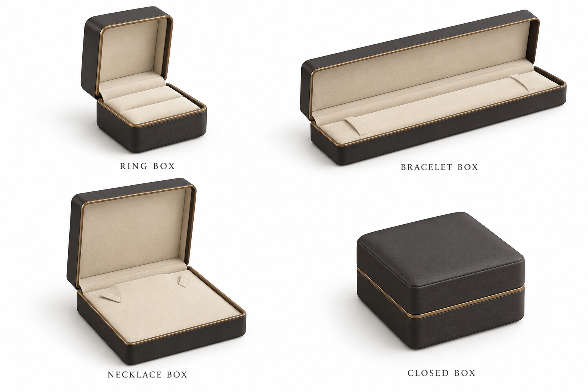
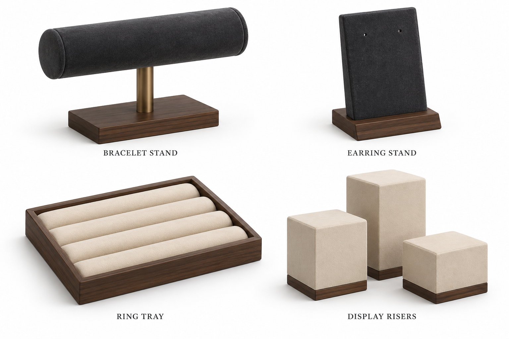
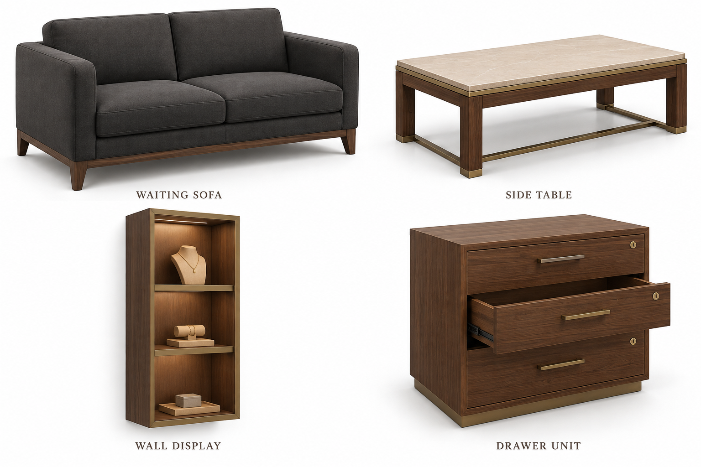
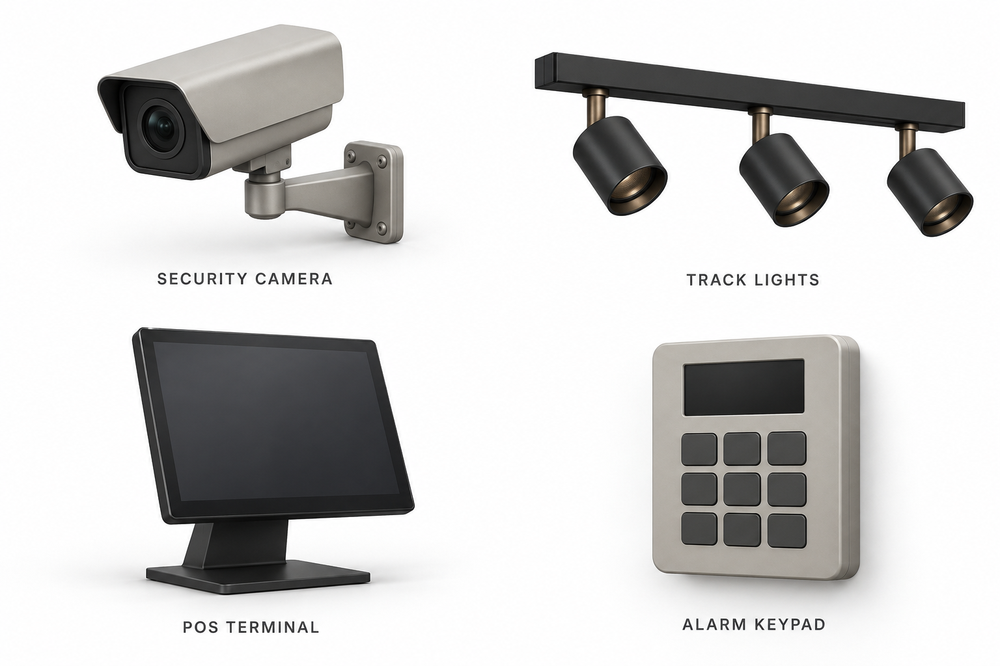
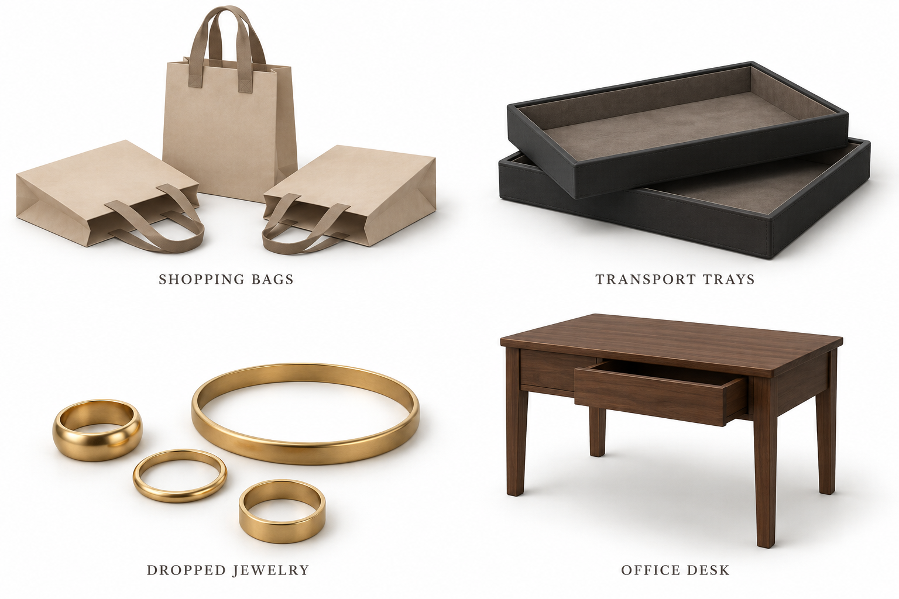

# Expanded store asset references
Eight generated reference sheets, 32 reference cells (including variants and grouped props), created 2026-10-11. These are modeling concepts, not Unity screenshots or completed low-poly meshes.

Download the original PNG using GitHub's raw-file download. Crop a single object and remove labels before image-to-mesh conversion. Use FBX for Unity or GLB for Blender cleanup. For grouped props, reconstruct one item and duplicate it where practical.

## Doors

## Glass and frames

## Safes

## Jewelry boxes

## Display inserts

## Shop furniture

## Shop fittings

## Small shop props

## Conversion and assembly notes
- Keep the established walnut, muted bronze, cream and charcoal style. Texture grain and tiny hardware in these renders are optional surface detail, not geometry requirements.
- Doors: separate frame and leaf; pivot each leaf at its hinge. Use the office door closed view as the primary shape reference and the open view for assembly intent. Generated variants are not exact technical projections.
- Glass: build simple panes manually in Blender/Unity for reliable topology and transparency. The glass renders communicate appearance and breakage placement. Exclude the gray presentation tile from the shard asset; reduce the exaggerated edge thickness in the reference. Place fragments flush on their supporting floor or display deck. Choose the actual glass type before treating any break pattern as a forensic detail.
- Safe: separate body, door, shelves and optional drawer. Use one consistent body across variants, with hinges on the right viewed from the front. Inner-door views may vary in proportions; establish dimensions in the model. The safe is a visual prop, not a mechanical engineering specification.
- Jewelry boxes: separate lids from bases if opening is required; pivot at the rear hinge. Empty inserts can remain part of the base. Suggested initial sizes: ring box 6 cm wide, bracelet box 22 cm long, necklace box 18 cm wide; these are proposed dimensions, not scale measurements from the images.
- Display risers, bags and loose jewelry: create individual assets, then arrange them in Unity. Avoid importing a fused group where independent scattering is needed.
- Furniture sheet: the generator added jewelry and lighting inside the wall cabinet. For the robbery version, omit that jewelry, keep stands separate and turn cabinet lighting off. Cabinet geometry is the useful reference.
- Keep drawers separate where they need to move. Retain existing interaction scripts when replacing visuals.
- Track lights and screens are off in the nighttime scenario; materials shown under studio lighting are not the final scene lighting.
- Start with simple colliders and shared materials. Inspect generated meshes for unnecessary subdivisions, inverted normals, fused parts and baked shadows. Rendering quality does not establish mesh triangle count or VR performance.
- For initial low-poly targets and the earlier tools, see the [original asset pack](../README.md). For room placement, follow the [layout plan](../../../../REFERENCE_LAYOUT_PLAN.md).

No Unity scene, runtime behavior or existing assets were replaced by this image batch.
