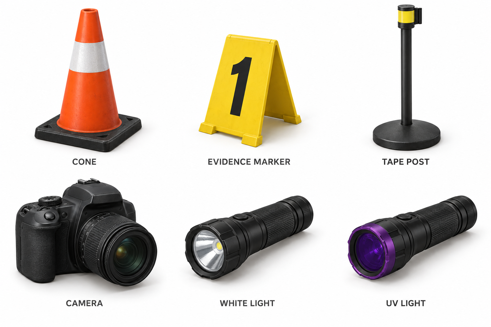
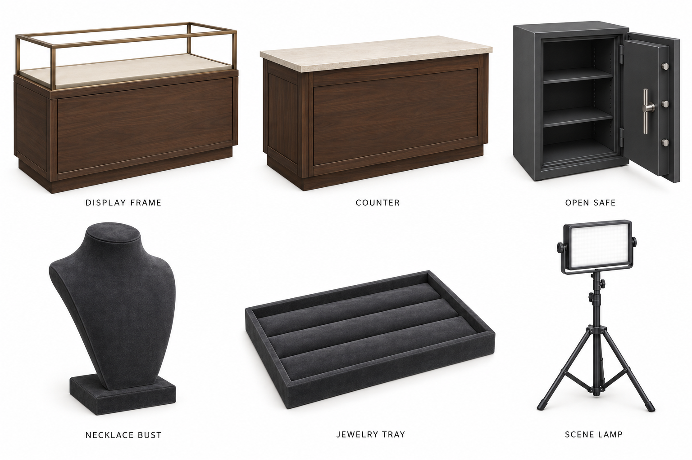
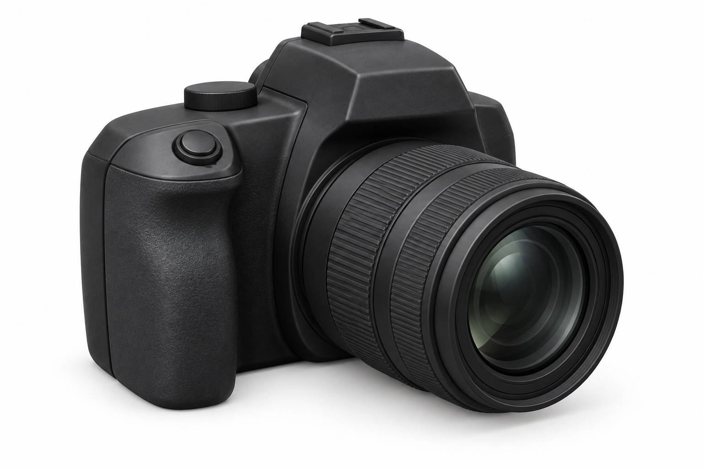
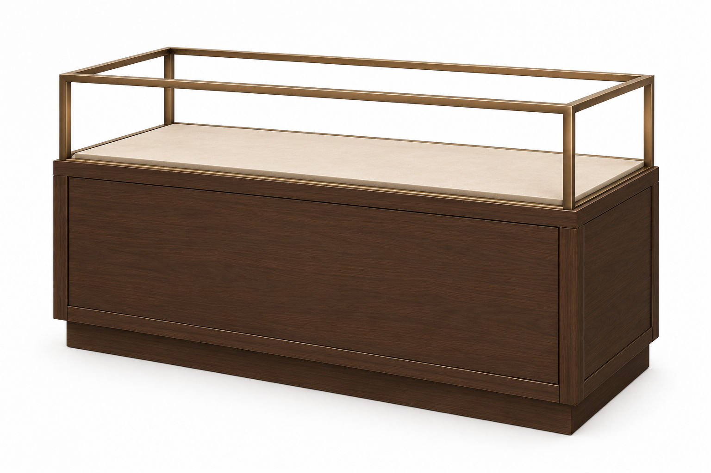

# Store assets — image-to-mesh references
Generated 2026-10-11 for the instructor-led jewelry-store VR demo. These are concept renders, not Unity screenshots or finished meshes. They match the proposed walnut, bronze, beige and charcoal store palette.

## Download and convert
Open an image below, then use GitHub's Download raw file button for its original PNG. Crop ONE object from a sheet, excluding labels and neighbors, before feeding it to an image-to-3D tool. The dedicated camera and cabinet images are preferred for those two objects. A single view cannot specify hidden surfaces exactly; keep those simple.

Export FBX (direct Unity workflow) or GLB (Blender cleanup/conversion). Keep the original generated mesh as well as any simplified version. Request low-poly geometry, separate movable components, and no baked background or shadows. Rendered grain, ribs and highlights are not required geometry.

## Tools

Cone, opaque upright A-frame evidence marker, tape post, unbranded DSLR, white flashlight and UV flashlight.

## Store fixtures

Display frame, checkout counter, open safe, necklace bust, jewelry tray and portable scene lamp.

## Camera — dedicated reference

Use a plain rear screen and simple controls on the unseen back. No branding. Lens ribs should be simplified or represented by a material, not hundreds of rings.

## Display case — dedicated reference

Glass is intentionally absent. Build glass as separate lightweight panes in Unity; broken variants can reuse this base and frame. Proposed module size: 1.8 m wide × 0.65 m deep × 1.05 m high, including approximately 0.35 m upper display space. These dimensions are design targets, not measured from the image.

## Modeling handoff
- Use meters. Apply transforms; put standing prop pivots at bottom center. Place the safe door pivot at its hinge. Keep safe body and door separate if it will move.
- Start with simple materials. The images suggest appearance; no detailed textures are needed for the initial mesh pass.
- Suggested starting triangle budgets, to be adjusted after profiling: marker/tray 100–500; cone/post/flashlight 300–1,000; bust 500–1,500; cabinet/counter 500–2,000; safe/lamp 1,000–3,000; camera 2,000–5,000. These are targets, not verified properties of generated meshes.
- Keep marker panels opaque with outward-facing normals, sufficient thickness and upright numbers. Numbers belong in a decal/material or runtime label.
- The tape post image is only the post. Connecting tape must be a separate runtime strip between paired posts, with readable text on both sides; do not bake a fixed cordon into the prop.
- White/UV beams, lamp illumination and camera screenshot behavior are Unity components, not mesh geometry. UV lens color alone does not implement UV evidence.
- Use simple primitive colliders. Check scale, normals, open surfaces and triangle count in Blender before import. Preserve existing grab/use/delete interactions when swapping visuals.
- For the robbery, reuse empty trays and busts as separate movable props. Tip selected stands and leave some empty, rather than baking a fully stocked cabinet.
- No scene geometry or runtime code was changed by this reference batch.

See the [store layout plan](../../../REFERENCE_LAYOUT_PLAN.md) and [environment reference gallery](../NightStore/README.md).
